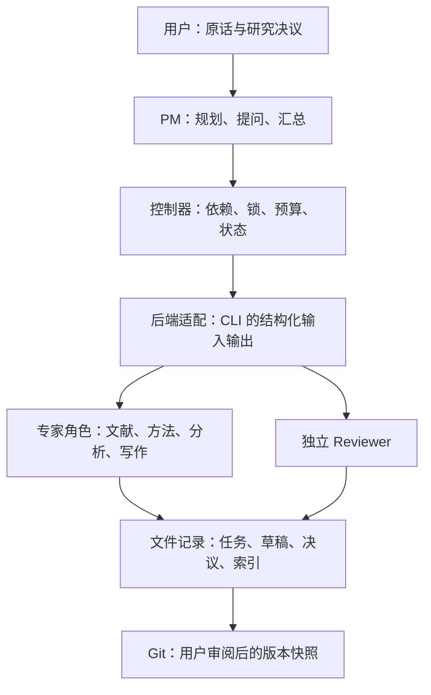
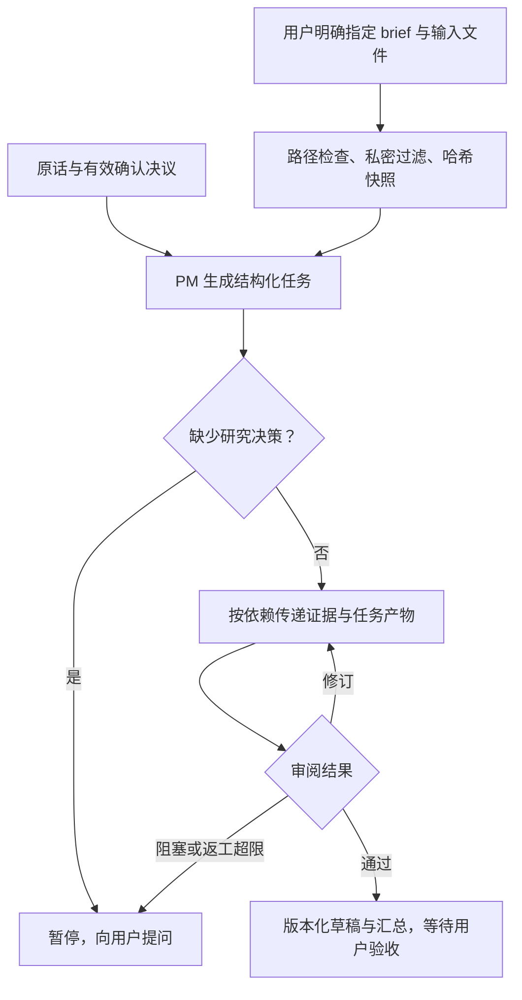
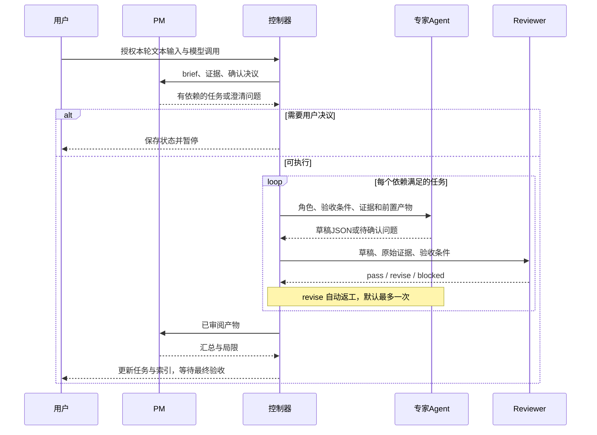

# paper-rsi-harness（MBA 论文工作目录与 PM 协调器）

版本：0.1.0 · 设计与资料核对日期：2026-09-15

这是可运行的轻量原型，不是论文网站、数据库系统或全自动代写服务。
交付包含：跨平台初始化器、每目录索引、原话与决议记录、六个 MBA Agent profile、串行 PM 调度器和离线自动化测试。
只依赖 Python 3.10+、Git，以及你自行安装登录的 Agent CLI。初始化会尝试联网用 pip 安装可选依赖 zvec（模糊匹配用，装入工具包同级 `vendor/`；失败仅告警并降级为标准库 difflib，不阻断初始化，见 [DEC-018](decisions/DEC-018-integrate-zvec.md)）；除此之外初始化不安装模型、不调用付费服务。

## 1. 快速安装

### 源码工程管理

本源码仓库的问题见 [issues/index.md](issues/index.md)，用户设计决策见 [decisions/index.md](decisions/index.md)，协作约定见 [AGENTS.md](AGENTS.md)。每次修改后运行 `python3 scripts/update_indexes.py --reason "本轮变更原因"`，更新各受管理目录的文件快照与变更时间线。根索引保留全工程事件；Git 忽略的试用目录、缓存和内部运行态不纳入扫描。

### 安装论文工作区

先安装 Python 3.10+ 和 Git。解压本工具包后运行：

macOS：

```bash
bash setup.sh "$HOME/Documents/paper-rsi-harness"
```

Windows PowerShell：

```powershell
.\setup.ps1 -Target "$env:USERPROFILE\Documents\paper-rsi-harness"
```

setup 脚本一次完成三件事：初始化论文工作区；把 `paper-spec-socratic` skill 安装到本机检测到的所有 agent（kimi、claude、codex、gemini 的 skill 目录）；把可选依赖 [zvec](https://github.com/alibaba/zvec) 自动安装到工具包同级 `vendor/`（已安装则跳过，失败仅告警），供 `paper.py` 的模糊匹配使用——未知命令会给出最近建议，如 `错误: 未知命令 inti；是否想输入 "init"？`，zvec 不可用时自动降级标准库 difflib。可选参数 bash 写法为 `--list`（只扫描不安装）、`--agent <名>`（只装到指定 agent）、`--no-skill`（只建工作区）、`--force`（覆盖已存在的 skill）；PowerShell 写法分别为 `-List`、`-Agent <名>`、`-NoSkill`、`-Force`。

若组织策略禁止 PowerShell 脚本，不修改执行策略，可直接运行同一核心程序：

```powershell
py -3 .\paper.py init --root "$env:USERPROFILE\Documents\paper-rsi-harness"
```

安装器支持带空格和中文的路径；不会覆盖已存在的同名文件，会补齐缺少的模板。若存在未知 `.paper-ai/` 或目标位于另一仓库内部，则暂停。
重复安装不是升级：已有程序、配置和入口保持原样；更新版本需要先审阅差异后显式替换。
已有 AGENTS.md/CLAUDE.md 会原样保留，因此需要手动合并入口指引。

初始化会建立本地 Git 仓库（或复用目标根目录已有仓库），不自动配置身份、不推送，也不自动暂存已有文件。
首次快照请检查文件后执行；身份未配置时使用你自己的 Git 身份：

```bash
cd /path/to/paper-rsi-harness
git status --short
git add AGENTS.md CLAUDE.md README.md workspace.json .gitignore .paper-ai decisions tasks notes writing references output index.md
git diff --cached --stat
git commit -m "Initialize MBA paper workspace"
```

此示例会暂存列出的目录；在已有目录中执行前必须检查其中是否含敏感内容。原始企业数据建议留在 materials/，不要无差别 `git add .`。
Git 不是备份；是否启用远程备份由用户另行决定。本交付不写入你的 GitHub 仓库。

## 2. 初始化后的结构

以下每个受管理目录都自动带 `index.md`，不逐个重复展开。

| 路径 | 用途 | 写入约定 |
|---|---|---|
| `materials/papers/` | 原始参考论文 | 用户添加，Agent 不修改 |
| `materials/data/` | 原始问卷、统计数据 | 用户添加，保留来源 |
| `materials/company/` | 企业案例资料 | 先脱敏，再显式授权使用 |
| `materials/private/` | 私密材料 | 不自动输入模型，Git 忽略 |
| `materials/guidelines/` | 论文规范文件原件 | 用户添加，Agent 不修改 |
| `notes/` | 读书笔记、用户原话摘录、已核对文本 | 人与 Agent 维护 |
| `notes/issues/` | 遗留问题登记（ISS 文件与索引） | Skill 写入，用户回答后关闭 |
| `decisions/` | 原话依据 + 决议 JSON | 新建记录，旧记录保留 |
| `tasks/` | 每次运行的计划与状态 JSON | 控制器统一写入 |
| `writing/outline/` | 用户确认的大纲 | 显式授权后修改 |
| `writing/spec/` | 论文编写 spec（paper-spec-socratic 产出） | 草案逐节经用户确认 |
| `writing/plan/` | 论文编写计划 | 草案逐节经用户确认 |
| `writing/chapters/` | 正式工作章节 | 显式授权后修改 |
| `writing/drafts/` | 人工交互模式的草稿 | 不覆盖确认稿 |
| `references/` | BibTeX 与引用核对 | 核验后登记 |
| `output/` | 用户确认的导出成果 | 不由模型自动发布 |
| `.paper-ai/profiles/` | 六个可编辑角色 JSON | 用户可调整 |
| `.paper-ai/rules/` | 共用写作与治理规则 | 单一规则来源 |
| `.paper-ai/templates/` | brief 和决议模板 | 可自行添加 |
| `.paper-ai/adapters/` | 后端调用配置、手工接入说明 | 用户启用已核对的 CLI |
| `.paper-ai/runs/` | 请求、模型响应、草稿、审阅和汇总 | 每次生成独立版本 |
| `.paper-ai/.runtime/` | 控制器锁、哈希缓存 | 自动维护，Git 忽略 |

根目录还有 `AGENTS.md`、`CLAUDE.md`、`workspace.json`。`workspace.json` 除 `default_backend`/`role_backends` 外还登记论文主题（`topic`）、学校要求（`school_requirements`）、AI 使用规范（`ai_disclosure_policy`）与 `formatting_guidelines`——后者为数组，元素为 `{file, title, version_or_date, locator}`，`file` 为工作区内相对路径（通常指向 `materials/guidelines/`），`locator` 记录章节/页码/条款定位；登记与变更走 `paper.py decision` 保证可追溯。内部目录 `.git/`、`.runtime/`、缓存和依赖目录不建立 index.md；符号链接不跟随。
没有 conversations/ 全量聊天库：原话和出处嵌入决议即可，符合本次确认。

## 3. 为什么参考这些开源项目

| 开源项目 | 官方实现特点 | 本设计借鉴 | 不引入的部分 |
|---|---|---|---|
| [CrewAI](https://github.com/crewAIInc/crewAI) | 角色、任务、Crews 与流程控制 | PM 管理角色与有依赖的任务 | 完整运行平台和额外依赖 |
| [MetaGPT](https://github.com/FoundationAgents/MetaGPT) | 多角色通过 SOP 协作形成交付物 | 明确每个角色的输入、产出、验收责任 | 软件公司角色原样套用 MBA |
| [BMAD-METHOD](https://github.com/bmad-code-org/BMAD-METHOD) | 专业角色、阶段工作流、持久决策上下文 | 让研究决策跨任务保留、按阶段推进 | 完整软件研发流程 |

以上是架构借鉴，不是集成或复制这些项目的代码；本工具的标准库实现与 profile 为本次编写。

## 4. MBA 角色分工

| 角色 | 任务 | 典型交付物 | 不可自行决定 |
|---|---|---|---|
| PM | 分解本轮目标、依赖协调、审阅返工、汇总 | 任务图、状态与问题清单 | 论文重大研究决议 |
| Researcher | 理论与文献证据整理 | 文献矩阵、来源及缺口 | 编造参考文献 |
| Methodologist | 检查管理问题与方法适配 | 案例/访谈/问卷/定量方案建议 | 替换研究方法、样本 |
| Analyst | 企业案例与给定数据解释 | 证据表、分析局限 | 虚构访谈、问卷和统计量 |
| Writer | 按确认方案辅助撰写 | 有来源的章节草稿 | 编造研究发现 |
| Reviewer | 独立审阅、管理价值和答辩检查 | pass/revise/blocked 与理由 | 用户最终验收 |

角色不是厂商产品。可让同一个 CLI 通过不同请求承担多个角色，或把角色映射到不同 CLI。
Reviewer 是独立调用上下文，但同一模型仍可能有共同偏差，不等于外部学术审查。
默认重点是实践管理问题、理论与案例结合、建议的可执行性；具体格式、章节结构、研究方法和 AI 使用披露以学校与导师要求为准。

## 5. 三类设计图

### 分层架构



### 数据流



### 模块交互时序



“PM 自动协调”由 PM 的结构化计划和控制器共同完成。控制器按计划顺序运行不同 Agent 进程，不要求用户逐个启动；v0.1 不做并行执行和无限循环。

## 6. 决议记录与变更处理

在 `notes/user-quote.txt` 保存用户准确原话，然后显式登记：

```bash
python3 .paper-ai/paper.py decision --root . --subject research-method --text "保留现有案例研究方法" --evidence notes/user-quote.txt --source-ref "用户会话/2026-09-15/第3条消息" --affects writing/outline --reason "依据本轮用户确认" --confirm
```

Windows 将 `python3` 换成 `py -3`。请将示例内容替换成真实原话、真实出处和真正确认的事项。
不加 `--confirm` 就是 proposed；PM 无权自动添加该参数。它是操作者登记，不是用户身份认证机制。

决议 JSON 包含：id、subject、created_at、status、quote、source_ref、decision、confirmed_at、supersedes、affects、reason。
新的确认决议如取代旧方案，添加 `--supersedes DEC-...`；不会删除或修改旧文件，读取时根据替代关系计算有效决议。
若确认一个草案，应依据用户原话新建 confirmed 记录；v0.1 不原地修改草案。

冲突规则：

1. proposed 不覆盖 confirmed。
2. 同一 subject 存在两个未建立替代关系的 confirmed 时，调度器停止，交由用户判断。
3. 替代关系不存在、跨主题或形成环路时，停止。
4. 时间戳用于展示顺序；不能以较新为由自动裁定。
5. `affects` 表示影响范围，供 PM 建议重新审阅相关章节；v0.1 不自动重写历史章节或恢复旧任务。
6. 运行中输入哈希、有效决议或配置变化时暂停；保留已有产物，不混合新旧依据继续工作。

只记录你显式提供的原话文件，不从 Kimi、WorkBuddy、Codex、Claude 的私有聊天记录目录抓取内容。

## 7. 每目录 index.md

```bash
python3 .paper-ai/paper.py index --root . --reason "补充导师对样本范围的意见，关联DEC编号"
```

每个 index.md 含文件列表、内容 SHA-256 前缀、带 UTC 时区的观察时间、子目录导航以及新增/修改/删除记录。
文件即使保留相同 mtime，只要内容变化也能识别；内容不变不会制造新的更新时间。
自动部分位于 `paper-index:start/end` 标记之间，标记外的用户说明保留。索引本身不作为索引对象，避免无限递归更新。

边界：时间是扫描发现变更的时间，不是假装精确的用户编辑时刻；两次扫描间多次修改只能发现最终状态，详细历史须依靠 Git 提交。
用户自行新增子目录会在下次扫描加入 index.md。删除整个子目录时，其文件删除会在根索引留下记录。
哈希缓存属于本地运行态，重新克隆后首次扫描是重建基线，旧 index.md 历史仍保留。
没有后台监听服务；初始化、每次 PM 运行结束和显式 index 命令会更新索引。全量哈希扫描大数据目录可能较慢。

## 8. Agent 适配与启用

| 后端 | v0.1 状态 | 启用条件 |
|---|---|---|
| Codex CLI | 提供非交互命令适配，未在本环境实测模型调用 | 安装、登录、核对本机 `codex exec --help`；启用配置 |
| Claude Code | 提供非交互、禁用内置工具及 MCP 的命令适配，未实测模型调用 | 安装、登录、核对本机 CLI 参数；启用配置 |
| Kimi Code | AGENTS.md 手工接入；自动后端默认禁用 | 提供禁用工具的已核对 profile 或隔离包装器后配置 command |
| WorkBuddy 桌面版 | 通用手工入口；自动后端默认禁用 | 尚未确认稳定无头接口，需官方受支持接口或用户提供包装器 |
| 自定义 Agent | command 数组接口 | stdin 接收请求，stdout 或 response 文件返回 JSON |

不能把 CodeBuddy IDE 的 Rules 文档直接当成 WorkBuddy 桌面版无头 API 的证明；上一轮的这处兼容推断已在本版修正。
同样，`.paper-ai/`、backends.json 和 profile JSON 是本工具自定义格式，不是所有产品原生自动识别的配置。

在 `.paper-ai/adapters/backends.json` 将已准备好的后端 `enabled` 改为 true；不要把密钥写进该文件或 command，认证使用各 CLI 已配置的方式。
根 `workspace.json` 示例配置片段如下，需要合并到现有文件而非替换整个文件：

```json
{
  "default_backend": "claude-code",
  "role_backends": {
    "pm": "claude-code",
    "researcher": "codex",
    "methodologist": "claude-code",
    "analyst": "codex",
    "writer": "claude-code",
    "reviewer": "codex"
  }
}
```

没有多个 CLI 也能开始：清空 `role_backends`，所有角色独立调用同一个后端即可。
角色 profile 在 `.paper-ai/profiles/*.json` 中，包含 name、goal、inputs、outputs、human_gate。它们作为请求上下文传入，不会自动安装为某产品的子 Agent。
新增后端只需新增 `enabled/command/response` 配置，并调整 role_backends。命令通过参数数组执行，不通过 shell 拼接。占位符 `{response}` 为输出文件，`{mcp}` 为空 MCP 配置文件。

安全边界：子进程独立工作目录不是 OS 沙箱。Claude 配置不加载项目设置并限制工具，但用户/产品运行环境仍应核对；Codex read-only 主要限制写入，不保证无法读取所有本机秘密或调用既有连接器。
对于企业敏感资料，应使用另行验证的隔离环境或获批准的本地模型。不要绕过权限确认，也不要为“自动化”开启全权限。
Kimi 官方文档提示 `--print` 隐式启用 `--afk`，会自动批准工具，因此本版没有将裸 `kimi --print` 配成可运行默认命令。

v0.1 不做自动联网检索：不新增检索命令、不调用外部搜索 API。references 条目中的 `agent_retrieved` 来源类型降级为「整理用户提供的检索结果文本」，须在核验依据中记录出处文本位置，不得代替联网检索。

## 9. 启动 PM

先编辑 workspace.json 的论文主题、学校要求和 AI 使用规范。创建 `notes/brief.md`，写明本轮管理问题、目标产物和现有证据。

先检查输入，不调用模型：

```bash
python3 .paper-ai/paper.py run --root . --brief notes/brief.md --input notes/literature.md --dry-run
```

确认显式指定文本可以交给所配置模型后：

```bash
python3 .paper-ai/paper.py run --root . --brief notes/brief.md --input notes/literature.md --allow-model-calls
```

自动传入内容还包括生效的 confirmed 决议（含用户原话）、角色规则以及前置任务产物；这也是对外模型数据范围的一部分。
目前只支持明确指定 UTF-8 的 Markdown/TXT/CSV/JSON/BibTeX 文件。PDF/Word/Excel 不自动解析，须先转成已核对的文本并保留页码、表格口径和出处。
没有自动互联网检索、统计代码执行或论文下载；Researcher/Analyst 在本原型中处理已经提供的文本证据，文献整理中的 agent_retrieved 同样仅限用户提供的检索结果文本。缺少资料就提问，不“补造”结果。

产物保存在 `.paper-ai/runs/RUN-.../T01-1/draft.md` 等版本目录中；状态在 `tasks/RUN-....json`。
默认最多 8 个任务，每任务最多返工 1 次，每次 CLI 调用超时 300 秒。正常全量上限为 34 次调用：规划1 + 8×(执行2+审阅2) + 汇总1；这不是费用硬上限。
API 拒绝、权限失败、输出不合规、超预算等情况立即记录 blocked，不自动换模型、提升权限或无限重试。
暂停后用户补充原话/材料，重新运行会创建新的 RUN；v0.1 没有断点自动恢复，也不重复修改旧 RUN。
最后的 awaiting_user_acceptance 表示机器审阅完成待用户验收，不意味着论文通过、可直接提交或统计结果已复算。

## 10. 更改写作主题与输出版本

想改写作主题时，先备份确认、再清空重置，两阶段门禁：

```bash
py -3 .paper-ai/paper.py reset-topic --topic "<新主题摘要>"              # 仅本地备份提交并打印待执行计划
py -3 .paper-ai/paper.py reset-topic --topic "<新主题摘要>" --confirm   # 确认后建 feature-<slug> 分支并重置工作区
```

- 只本地提交，不 push、不配置 remote；仓库尚无提交时以首次提交作为备份点。
- 只按上一版本迭代、不清空时用 `--branch-only` 只建分支；中文摘要需显式 `--allow-unicode-branch`；目标分支已存在则拒绝执行。
- 重置仅回空 workspace.json 的 topic/school_requirements/ai_disclosure_policy/formatting_guidelines，保留后端配置，不触碰 materials/、.gitignore、AGENTS.md/CLAUDE.md 的用户合并内容。
- 清空后请对 Agent 说「帮我梳理论文主题」，重新启动 paper-spec-socratic 流程。

输出版本命名：版本标记放在 `output/` 内的目录名，命名应匹配 `output/vX.Y-release/`（释放版本）与 `output/vX.Y-RC/`（候选版本），即目录名符合 `^v\d+\.\d+-(release|RC)$`；index 时对不规范版本名给出警告（warning），不拒绝扫描。目录内放实际产物与版本说明。版本号不写入 workspace.json（其 version 字段是工具版本）；与 feature- 分支命名相互独立，新主题版本从 v0.1-RC 起重新计数。

确认登记论文规范时用 decision 的 `--guideline` 参数一步完成留痕与写入：

```bash
python3 .paper-ai/paper.py decision --root . --subject formatting-guidelines --guideline file=materials/guidelines/thesis-guide.md,title=硕士学位论文格式规范,version=2026版,locator=第3章 --text "<用户确认原话>" --evidence notes/user-quote.txt --source-ref "<用户会话出处>" --confirm
```

Windows 将 `python3` 换成 `py -3`；去掉 `--confirm` 则只留 proposed 决议，不写入 workspace.json。

## 11. 已做验证与未做验证

运行测试：

```bash
python3 -m unittest -v test_paper.py
```

已在 Linux 与 Windows（py -3，Python 3.14）环境运行自动化测试，覆盖初始化、Git、重复安装保留内容、索引稳定性及删除、路径越界、锁、决议冲突与环路、任务依赖校验、禁用后端、上下文预算、PM提问暂停、审阅返工、真实子进程的离线模拟链路，以及模糊匹配（zvec 后端真实执行、difflib 降级、CLI 未知命令建议与无关输入不建议）。
mock_backend.py 仅为测试夹具，不是 AI，不会联网，不用于生成论文；不安装到用户论文目录。
2026-09-23 已在 Windows 实测 `setup.sh` 与 `setup.ps1` 的工作区初始化及 zvec 自动安装/跳过分支（`setup.ps1` 同轮补了 UTF-8 BOM 以兼容 Windows PowerShell 5.1）。

未完成：macOS 原生系统验证，四种产品真实账号/CLI 端到端测试，MBA 内容质量评测，CLI 进程树超时清理和强隔离安全评审。请先用非敏感样例验证本机后端再正式使用。
本工具不会读取本环境凭据来替你测试；除 setup 脚本明确声明的 skill 复制、`vendor/` 依赖安装与工作区初始化外，不在你的电脑上执行其他安装。

## 12. 官方参考

- [CrewAI：角色协作与流程](https://github.com/crewAIInc/crewAI)
- [MetaGPT：角色与 SOP](https://github.com/FoundationAgents/MetaGPT)
- [BMAD：工作流和决议上下文](https://github.com/bmad-code-org/BMAD-METHOD)
- [Codex 非交互运行](https://developers.openai.com/codex/non-interactive-mode)
- [Codex AGENTS.md](https://developers.openai.com/codex/guides/agents-md/)
- [Claude Code 非交互运行](https://code.claude.com/docs/en/headless)
- [Claude Code CLI 参数](https://code.claude.com/docs/en/cli-reference)
- [Claude Code CLAUDE.md 导入](https://code.claude.com/docs/en/memory)
- [Kimi CLI 命令和批准模式](https://moonshotai.github.io/kimi-cli/en/reference/kimi-command.html)

以上链接支持产品事实；目录布局、MBA角色、冲突规则和实现取舍是本交付的设计建议，不是这些项目声称原生具备的 MBA 功能。
